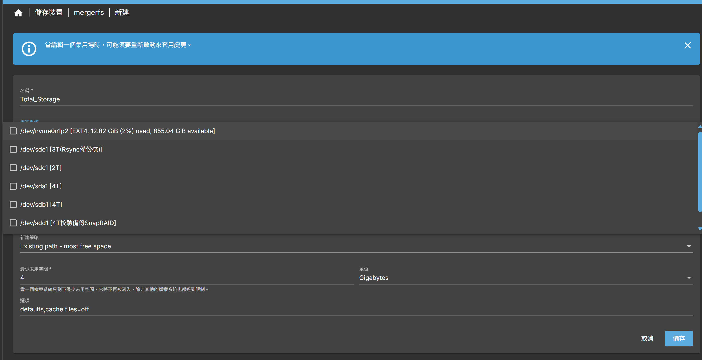
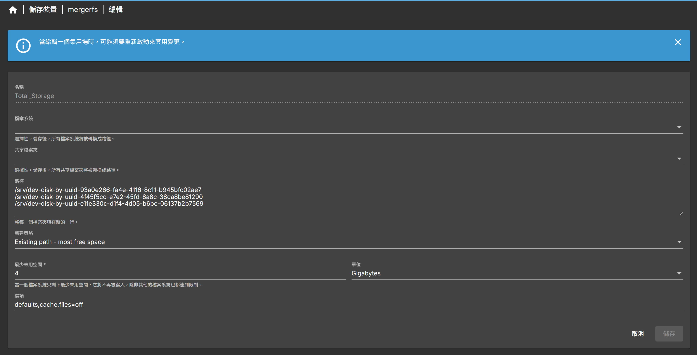
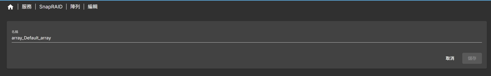
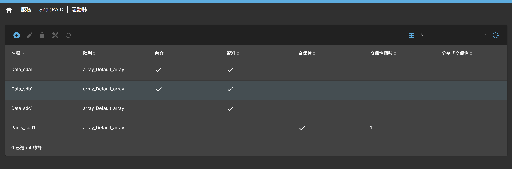
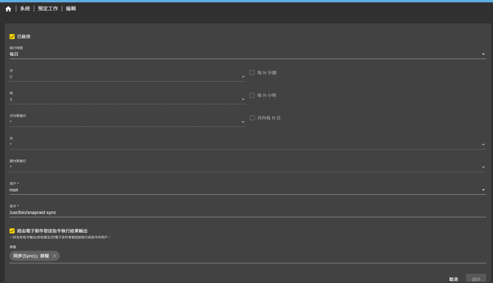
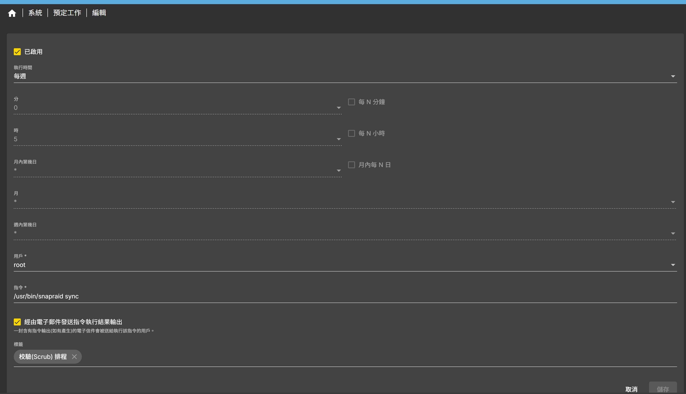

# MergerFS + SnapRAID 合併硬碟與備份

在 OpenMediaVault 上用 MergerFS 把多顆硬碟合併成一個儲存空間，再用 SnapRAID 提供校驗備份，適合家用 NAS 與影音伺服器。

## 目錄

- [簡介](#簡介)
- [與傳統 RAID 比較](#與傳統-raid-比較)
  - [架構差異](#架構差異)
  - [資料完整性與效能](#資料完整性與效能)
  - [適用場景](#適用場景)
- [安裝 OMV 外掛](#安裝-omv-外掛)
- [建立 MergerFS 儲存池](#建立-mergerfs-儲存池)
- [設定 SnapRAID](#設定-snapraid)
- [排程同步與校驗](#排程同步與校驗)

## 簡介

- **MergerFS**：基於 FUSE 的聯合檔案系統，可以把多個獨立的硬碟（容量、格式不同也可以）合併成單一掛載點。
- **SnapRAID**：透過額外儲存的奇偶校驗資料（Parity）提供容錯能力，特別適合檔案不常變動的環境。

| 系統 | 提供的優點 |
| :--- | :--- |
| MergerFS | 提供一個容易管理的大型儲存池，Docker 等應用程式不需要知道資料實際放在哪一顆硬碟。 |
| SnapRAID | 為儲存池提供資料保護與完整性檢查，防範硬碟故障與資料靜默損壞。 |

## 與傳統 RAID 比較

### 架構差異

| 特性 | MergerFS + SnapRAID | 傳統 RAID（RAID 5/6/10） |
| :--- | :--- | :--- |
| **設計方式** | 分層儲存 + 離線（快照式）容錯，資料管理與容錯分開 | 一體化即時容錯，多顆硬碟視為單一單元 |
| **檔案存放** | 每個檔案完整存在單一硬碟上 | 檔案被切塊（Striped）分散寫入多顆硬碟 |
| **混用不同硬碟** | 支援，可混用不同容量與轉速 | 不建議，以最小容量為準 |
| **擴充性** | 極佳，隨時加入新硬碟，不需重建 | 較差，擴充或更換通常需要長時間重建 |

### 資料完整性與效能

| 項目 | MergerFS + SnapRAID | 傳統 RAID（以 RAID 5 為例） |
| :--- | :--- | :--- |
| **容錯機制** | 快照式 Parity，需手動或排程 `sync` 才會保護新資料 | 即時 Parity，每次寫入同步更新 |
| **寫入速度** | 快，接近單顆硬碟速度 | 較慢，需要計算 Parity |
| **災難復原** | 即使 Parity 盤損壞，其他資料盤上的檔案仍完整可讀 | 任一硬碟故障，單獨一顆硬碟的資料無法讀取 |
| **誤刪復原** | 可以，在下一次 `sync` 前發現即可用 `fix` 復原 | 無法，刪除後立即從所有硬碟移除 |
| **Bit Rot 偵測** | 內建，`scrub` 可檢查並修復靜默損壞 | 通常沒有，需要特殊硬體或軟體 |

### 適用場景

| 方案 | 核心價值 | 適用場景 |
| :--- | :--- | :--- |
| **MergerFS + SnapRAID** | 彈性、容量利用率、檔案可讀性、資料完整性檢查 | 家用 NAS、影音伺服器、冷儲存，資料不常變動的環境 |
| **傳統 RAID** | 效能、即時容錯、高可用性 | 資料庫、虛擬化主機、高頻讀寫、需要零停機的正式環境 |

## 安裝 OMV 外掛

在 OMV 網頁的外掛區安裝以下兩個外掛：

```text
openmediavault-mergerfs
openmediavault-snapraid
```

## 建立 MergerFS 儲存池

1. 進入 **儲存裝置** → **mergerfs** → **新建**，勾選要合併的硬碟。**記得保留容量最大的一顆給 SnapRAID 當校驗盤，不要加入合併。**

   

2. 建立完成後如下：

   

3. 建立後會在 `/srv/mergerfs` 下看到儲存池資料夾：

   ```bash
   ls /srv/mergerfs
   ```

   ```text
   Total_Storage
   ```

4. 確認儲存池大小：

   ```bash
   df -h /srv/mergerfs/Total_Storage
   ```

   ```text
   Filesystem              Size  Used Avail Use% Mounted on
   Total_Storage:<UUID>    9.0T  439G  8.6T   5% /srv/mergerfs/Total_Storage
   ```

## 設定 SnapRAID

1. 進入 OMV **服務** → **SnapRAID**。
2. 會看到四個頁籤：設定、陣列、驅動器、規則（通常只會用到「陣列」與「驅動器」）。
3. 建立陣列，名稱例如 `array_Default_array`：

   

4. 建立驅動器。以下範例中 MergerFS 使用 sda1（4T）、sdb1（4T）、sdc1（2T），校驗盤為 sdd1（4T）。**校驗盤只能有一顆，勾選「奇偶性」並將奇偶性個數設為 1。**

   | 磁碟名稱 | 內容（Content） | 資料（Data） | 奇偶性（Parity） | 說明 |
   | :--- | :---: | :---: | :---: | :--- |
   | Data_sda1 | 是 | 是 | 否 | 內容盤 1：儲存資料並存放索引 |
   | Data_sdb1 | 是 | 是 | 否 | 內容盤 2：儲存資料並存放索引 |
   | Data_sdc1 | 否 | 是 | 否 | 資料盤：僅儲存資料 |
   | Parity_sdd1 | 否 | 否 | 是 | 校驗盤：僅儲存校驗資料 |

   

## 排程同步與校驗

1. 查詢 SnapRAID 執行檔的位置：

   ```bash
   whereis snapraid
   ```

   ```text
   snapraid: /usr/bin/snapraid /etc/snapraid /usr/share/man/man1/snapraid.1.gz
   ```

2. 到 OMV **系統** → **預定工作** 新增兩個排程：

   | 排程 | 建議頻率 | 指令 |
   | :--- | :--- | :--- |
   | 同步（Sync） | 每日 | `/usr/bin/snapraid sync` |
   | 校驗（Scrub） | 每週 | `/usr/bin/snapraid scrub` |

3. 同步（Sync）排程設定：

   

4. 校驗（Scrub）排程設定（指令欄位請填 `/usr/bin/snapraid scrub`）：

   
