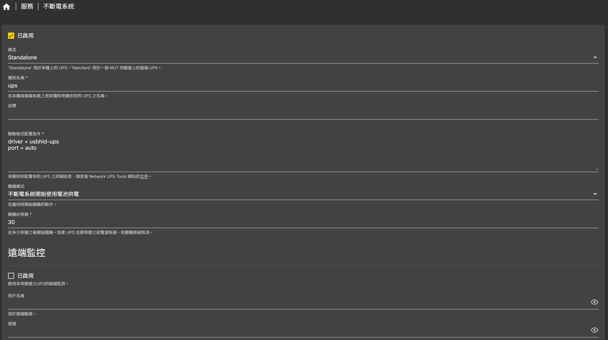

# UPS 不斷電系統設定

在 OpenMediaVault 上設定 UPS，停電時讓 NAS 自動安全關機，避免硬碟與資料損壞。

## 目錄

- [前置需求](#前置需求)
- [OMV 設定](#omv-設定)
- [測試連線](#測試連線)
- [常用欄位說明](#常用欄位說明)

## 前置需求

- UPS 以 USB 線連接到 NAS
- 在 OMV 外掛區安裝 `openmediavault-nut`

## OMV 設定

進入 OMV **服務** → **不斷電系統**，依照下圖設定：

| 欄位 | 設定值 |
| :--- | :--- |
| 模式 | Standalone（UPS 直接接在本機） |
| 識別名稱 | `ups` |
| 驅動程式配置指令 | `driver = usbhid-ups`<br>`port = auto` |
| 關機模式 | 不斷電系統開始使用電池供電 |
| 關機計時器 | `30`（秒） |



## 測試連線

SSH 連線到 NAS 後執行：

```bash
upsc ups@localhost
```

輸出範例（CyberPower CP1000AVRLCDa）：

```text
Init SSL without certificate database
battery.charge: 100
battery.charge.low: 10
battery.charge.warning: 20
battery.mfr.date: CPS
battery.runtime: 3297
battery.runtime.low: 300
battery.type: PbAcid
battery.voltage: 13.6
battery.voltage.nominal: 12
device.mfr: CPS
device.model: CP1000AVRLCDa
device.serial: <UPS序號已隱藏>
device.type: ups
driver.name: usbhid-ups
driver.parameter.pollfreq: 30
driver.parameter.pollinterval: 2
driver.parameter.port: auto
driver.parameter.synchronous: auto
driver.version: 2.8.0
driver.version.data: CyberPower HID 0.6
driver.version.internal: 0.47
driver.version.usb: libusb-1.0.26 (API: 0x1000109)
input.voltage: 113.0
input.voltage.nominal: 120
output.voltage: 113.0
ups.beeper.status: enabled
ups.delay.shutdown: 20
ups.delay.start: 30
ups.load: 11
ups.mfr: CPS
ups.model: CP1000AVRLCDa
ups.productid: 0501
ups.realpower.nominal: 600
ups.serial: <UPS序號已隱藏>
ups.status: OL
ups.test.result: No test initiated
ups.timer.shutdown: -60
ups.timer.start: -60
ups.vendorid: 0764
```

## 常用欄位說明

| 欄位 | 說明 |
| :--- | :--- |
| `battery.charge` | 電池電量（%） |
| `battery.runtime` | 預估電池可供電時間（秒） |
| `ups.load` | 目前負載（%） |
| `ups.status` | `OL` = 市電供電中，`OB` = 電池供電中，`LB` = 電量過低 |
